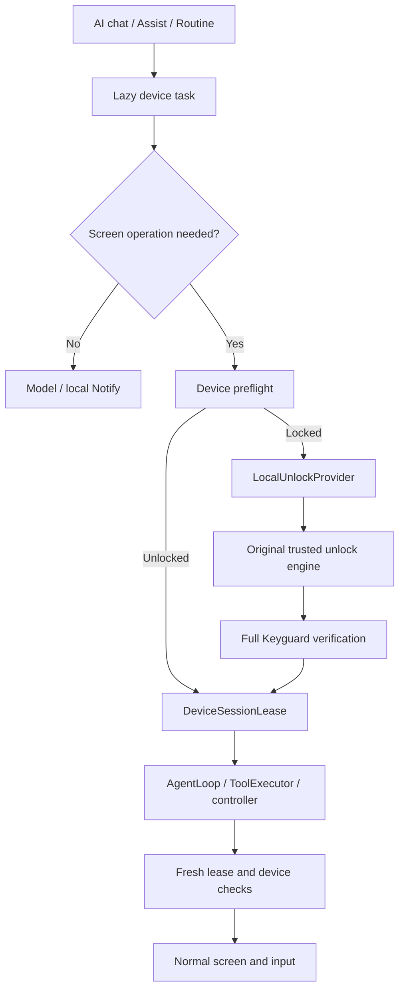

# UnlockTime Unified architecture

## Composition

The fixed OpenPhoneUse application is the main project. `PhoneUseApp` initializes `UnlockTimeRuntime`, the shared device boundary, the task authority, then `AppGraph`. A startup migration check precedes scheduling. The namespace remains com.phoneuse, while applicationId is org.localwake.app. The old source directories remain outside this checkout as immutable references.

## Single service and credentials

Only `org.localwake.app.accessibility.LocalWakeAccessibilityService` is registered as an AccessibilityService. It inherits the open PhoneUse service implementation, implements `UnlockAccessibilityHost`, and preserves the old component identity, Samsung creation fallback, connection checks, interrupt behavior and unbind cleanup. The service has full ordinary AI accessibility capabilities; the local authentication path still selects trusted SystemUI only. Overlay, watcher and controller lifetime belong to this same service.

`UnlockTimeRuntime` owns the original credential store, task compatibility facade, compatibility database, local scheduler and execution mutex. `Context.localWake` resolves this runtime without casting the Application. The credential provider is an internal Kotlin API; it is not serialized, exported or registered as an AI tool. It wakes with the original WakeActivity and calls the original dynamic-bound pattern/PIN/password engine, including durable single-attempt protection.

## Device sessions

The process-wide `DeviceExecutionCoordinator` grants identity-based leases with monotonically increasing epochs. Ownership is exclusive among UNLOCK, AGENT, ROUTINE, CREDENTIAL_EDIT and MIGRATION. Sensitive reservations survive revocation until their UI owner closes them. A platform input fence outlives coroutine cancellation and is released only by actual completion/rejection/cancellation callbacks or return from synchronous input.

`AndroidDeviceAccess.task` is lazy. It does not unlock for pure chat. The first actual device operation performs preflight; later operations only validate the current lease, task job, current routine revision, Keyguard, service instance and connection generation. Async tree/screenshot reads carry their originating lease. Late callbacks may not publish into a new epoch. Relock/disconnect/stop cancels the current task; no repeated authentication occurs inside that interrupted run.

`LocalInputSession` carries the native owner into the preserved local algorithm. Native gestures, node actions and app launches share the input fence. Credential setup reserves ownership before system authentication and holds it through the editor and exit animation. Own application windows are excluded from AI screen/coordinate operations, including split-screen panes.

## AI path

AgentRunner, AgentLoop/Helper, ToolExecutor, controller, Assist suggestions, screen attachments and debug device probes share the boundary. Model HTTP send/stream/retry guards are bound to the originating task. Historical screen captures do not silently force a new unlock. Original risk judgment, confirmation and taint logic remain. Pure non-screen tools may run without entering a device session; any tool that actually opens an Android activity (including clock alarms/timers) must enter the device path.

## Scheduling

`RoutineSystem` owns unified definitions, recurrence and execution after a verified journal cutover. Native `OpenAppsSequence` is deterministic and model-free. `Trigger.Once` preserves absolute one-time execution. Legacy ScheduleRepository reads/guard/history calls become a compatibility facade, while the old persisted source remains intact. A durable occurrence ledger enforces revision/token/epoch claims and unknown-result no-replay.

Native execution reserves a handoff slot and bounded wake lock before claiming, then runs in the application scope so broadcast callers finish promptly. The same device coordinator arbitrates against AI. Edits cancel the native handoff/lease and invalidate the persisted revision. Work deferred due to a busy device resumes when ownership becomes free. No new task grant is needed; AI routines inherit the local global setting.

See the [screen-access inventory](UNIFIED_SCREEN_ACCESS_INVENTORY.md) and [device test results](evidence/validation-summary.json).
